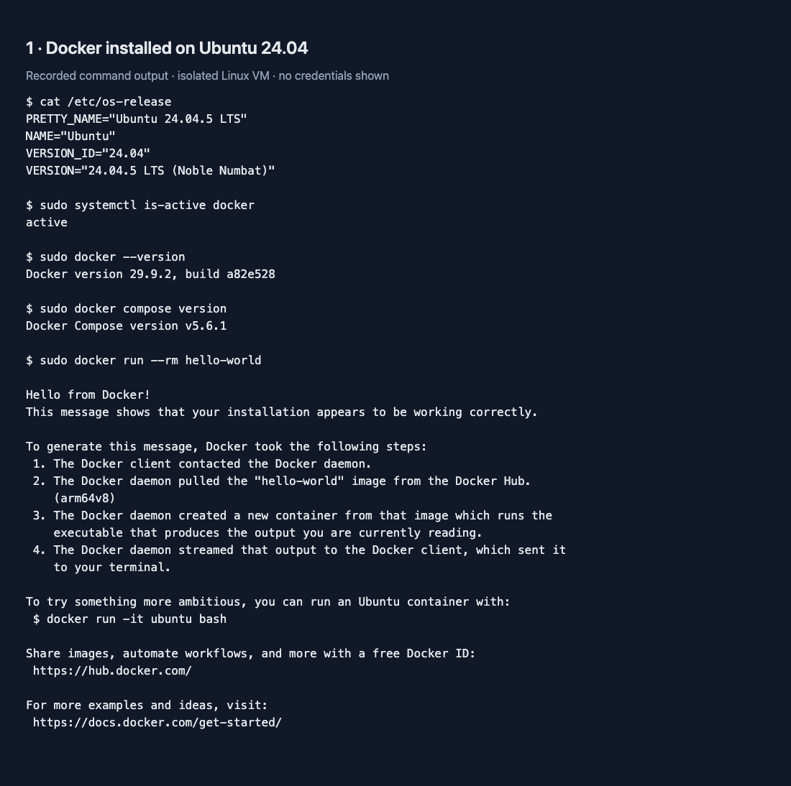
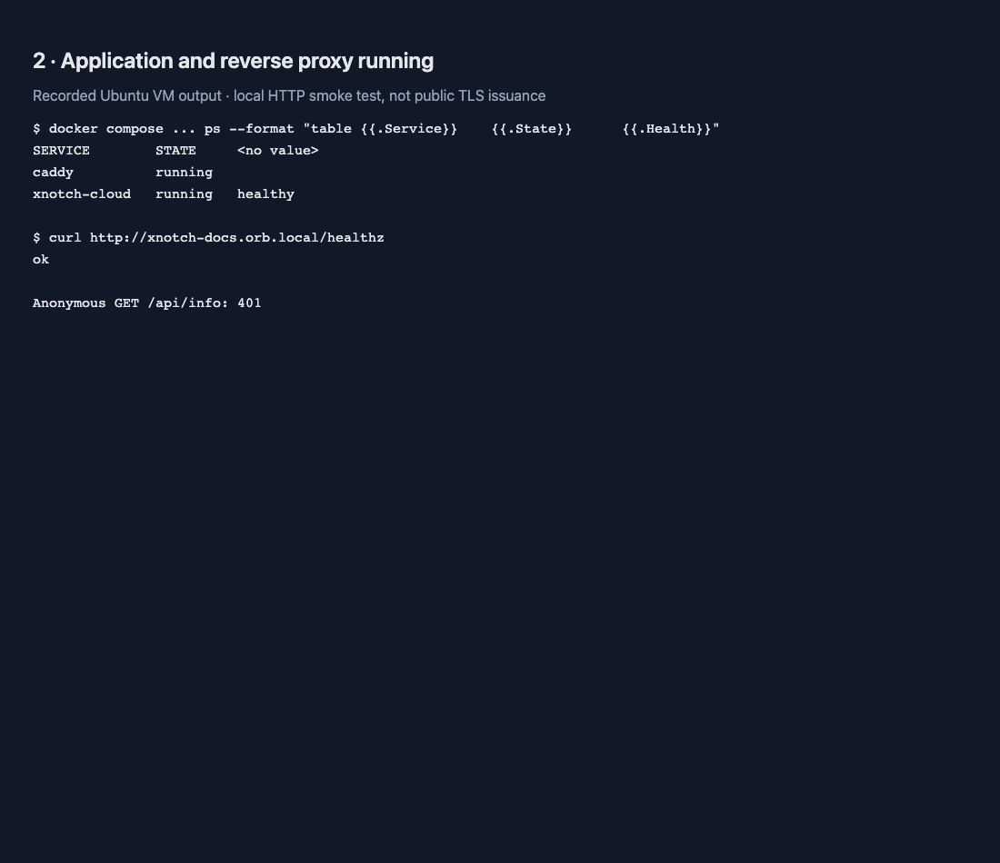
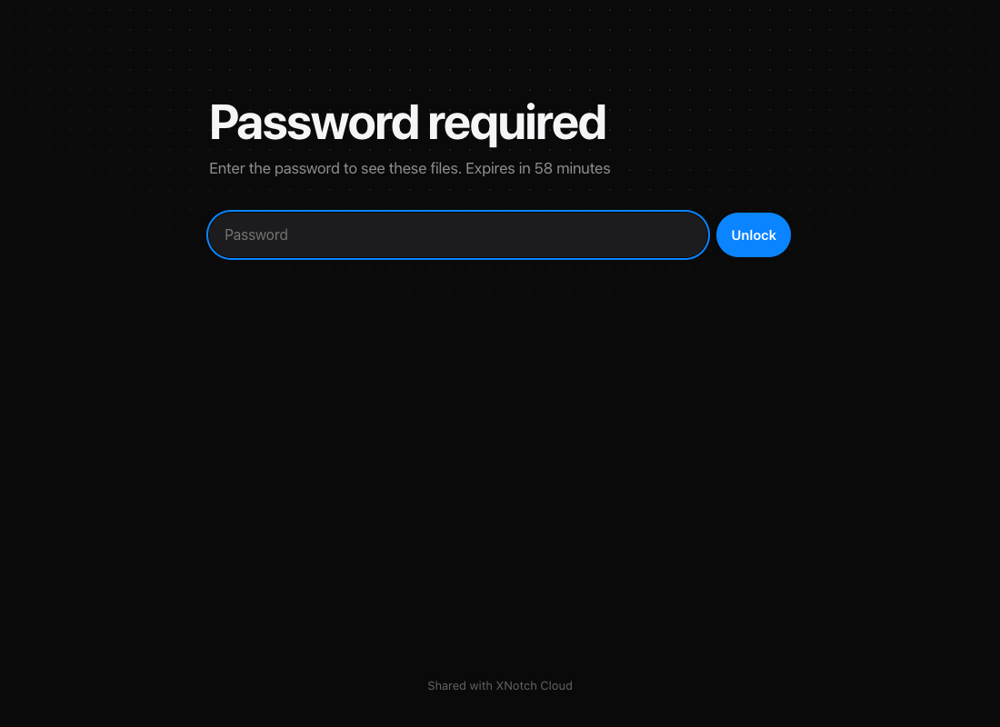
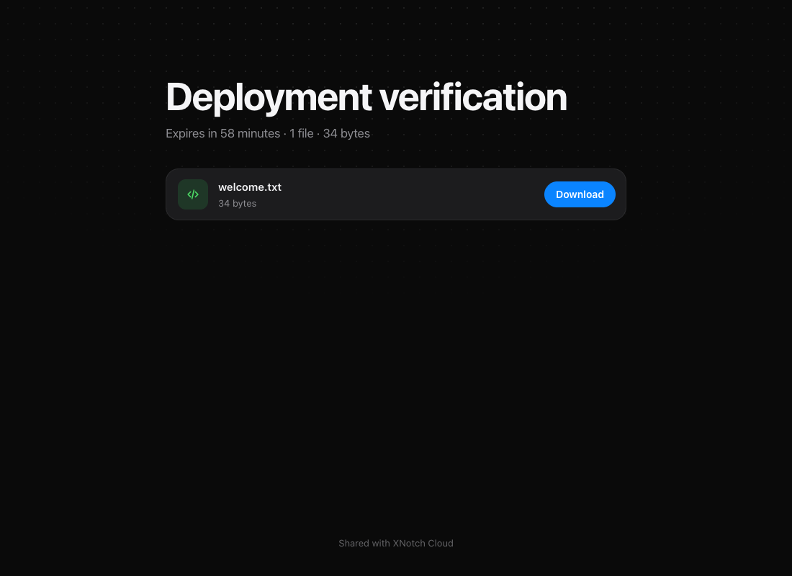

# Self-hosting XNotch Cloud

How to run XNotch Cloud for real: an illustrated Ubuntu + Docker + HTTPS walkthrough,
then shorter notes for Dokploy, S3-compatible storage and Raspberry Pi.
For settings, the API and relay internals, see the [reference](REFERENCE.md).
Before a rollout for a team or customer, read the [security assessment](SECURITY.md).

- [Linux server walkthrough (Ubuntu 24.04 LTS)](#linux-server-walkthrough-ubuntu-2404-lts)
- [Deploy with Dokploy](#deploy-with-dokploy)
- [S3-compatible storage](#s3-compatible-storage)
- [Other reverse proxies](#other-reverse-proxies)
- [Raspberry Pi](#raspberry-pi)

## Linux server walkthrough (Ubuntu 24.04 LTS)

This targets a **fresh Ubuntu Server 24.04 LTS, amd64 or arm64**, with sudo access.
Use a dedicated VM per customer. Start with 2 CPUs and 4 GiB RAM for building, plus
disk space for images and retained uploads; measure actual demand before choosing
production limits. Commands run on the Linux server over SSH.

The examples use `drop.example.com`: replace it with your domain. You need:

- an A record pointing to the server's public IPv4 address (and an AAAA record only
  if IPv6 works);
- inbound TCP 80/443 for Caddy, and outbound DNS/HTTPS for packages, images and
  certificates;
- SSH restricted to your administrator network.

For VPN-only deployments, use your organization's TLS/PKI and ingress instead of
this public certificate example. Public recipients must be able to reach the host.

The screenshots were recorded on an isolated Ubuntu 24.04 arm64 VM using local HTTP
and disposable demo data; the steps below use HTTPS. Public DNS and certificate
issuance are not shown. See [how they were captured](images/README.md).

### 1. Install Docker Engine and Compose

Connect with `ssh your-admin@your-server`. Check the host:

```sh
cat /etc/os-release
uname -m
df -h /
```

On an existing host, have the administrator review conflicting Docker/containerd
packages and workloads first. The following installs from Docker's official apt
repository; it does not uninstall existing runtimes.

```sh
sudo apt-get update
sudo apt-get install -y ca-certificates curl git openssl nano
sudo install -m 0755 -d /etc/apt/keyrings
sudo curl -fsSL https://download.docker.com/linux/ubuntu/gpg -o /etc/apt/keyrings/docker.asc
sudo chmod a+r /etc/apt/keyrings/docker.asc
sudo tee /etc/apt/sources.list.d/docker.sources > /dev/null <<EOF_DOCKER
Types: deb
URIs: https://download.docker.com/linux/ubuntu
Suites: $(. /etc/os-release && echo "$VERSION_CODENAME")
Components: stable
Architectures: $(dpkg --print-architecture)
Signed-By: /etc/apt/keyrings/docker.asc
EOF_DOCKER
sudo apt-get update
sudo apt-get install -y docker-ce docker-ce-cli containerd.io docker-buildx-plugin docker-compose-plugin
sudo systemctl enable --now docker
sudo docker run --rm hello-world
sudo docker compose version
```



Expect “Hello from Docker!” and a Compose version. Keep using `sudo`: membership
in the `docker` group effectively grants root-level access.
See [Docker's Ubuntu installation reference](https://docs.docker.com/engine/install/ubuntu/)
for other Ubuntu versions and conflicting packages.

### 2. Download and configure XNotch Cloud

```sh
git clone https://github.com/Lxvi101/XNotch.git
cd XNotch/Server
git rev-parse HEAD
umask 077
cp .env.example .env
chmod 600 .env
# Generate directly into .env without printing the token:
sed -i "s/^API_TOKEN=$/API_TOKEN=$(openssl rand -hex 32)/" .env
nano .env
```

Record the commit SHA in your deployment inventory. For production, check out a
reviewed release or commit before building. In `.env`, keep the generated API token
and set these values (adapt the limits to your organization's policy):

```dotenv
PUBLIC_URL=https://drop.example.com
SITE_NAME=Company File Drop
ID_LENGTH=22
MAX_FILE_SIZE=1073741824
DEFAULT_EXPIRY=86400
MAX_EXPIRY=604800
STORAGE=local
RELAY=off
LOG_FORMAT=json
```

This permits 1 GiB per file and at most seven days of link lifetime. It does not
limit total storage. Set `RELAY=on` only if you need the iPhone internet relay.
Use a password manager to give the API token to authorized Mac clients; keep it out
of screenshots, tickets and Git. Docker administrators can read container
environment variables even when `.env` is protected.

### 3. Start with HTTPS

The supplied [HTTPS overlay](../deploy/compose.https.yml) adds Caddy and persistent
certificate storage. Only Caddy publishes host ports; XNotch's port 8080 stays on
the Docker network, so leave the commented `ports:` section in `docker-compose.yml`
commented. Ports 80 and 443 must be free. If you already have an ingress on those
ports, route it to the private application port instead (see
[Other reverse proxies](#other-reverse-proxies)).

Run all following commands from `XNotch/Server`:

```sh
sudo docker compose -f docker-compose.yml -f deploy/compose.https.yml config --quiet
sudo docker compose -f docker-compose.yml -f deploy/compose.https.yml up -d --build
sudo docker compose -f docker-compose.yml -f deploy/compose.https.yml ps
sudo docker compose -f docker-compose.yml -f deploy/compose.https.yml logs --tail=50 caddy
```

The first Rust build can take several minutes. Wait for `xnotch-cloud` to become
healthy and Caddy to start. Caddy obtains and renews a certificate for `PUBLIC_URL`
and redirects HTTP to HTTPS. Its `/data` volume holds certificate private keys;
protect it. See [Caddy's reverse-proxy guide](https://caddyserver.com/docs/quick-starts/reverse-proxy).



At your network or provider firewall, allow 80/443 to this host and SSH only from
your admin network. **Do not allow 8080.** Docker-published ports can bypass UFW
rules, so use an upstream firewall and verify from a different machine.
See [Docker's firewall documentation](https://docs.docker.com/engine/network/packet-filtering-firewalls/).

The overlay also pins Caddy to a fixed private IP and trusts only that address for
client identity, so per-client rate limits see real client IPs (details in the
[reference](REFERENCE.md#rate-limiting-and-client-identity)). For large untrusted
workloads, add ingress connection/concurrency limits and a WAF.

### 4. Verify access before uploading real data

From your Mac or another machine (replace the domain):

```sh
curl --fail --show-error https://drop.example.com/healthz
# Expected: ok
curl -s -o /dev/null -w '%{http_code}\n' https://drop.example.com/api/info
# Expected: 401 (no token)
curl --connect-timeout 5 http://YOUR_SERVER_IP:8080/healthz
# Expected: connection refused or timeout, not ok
```

Do not use `curl -k` to work around certificate errors; fix DNS, clock, firewall
or certificate-chain problems first. Test both IPv4 and IPv6 if you publish both.

In **XNotch → Settings → Cloud**, enable Cloud, enter `https://drop.example.com` and
the API token, and use **Test connection**. Upload a harmless sample file from the
shelf, then check in a private browser window:

1. A new link (encrypted by default) ends in `#` and a 43-character key. In the private
   window the page lists the file by its real name, and the downloaded contents match
   the original. Test the *complete* link, key included.
2. A password-protected drop hides its title and files before unlocking; a wrong
   password fails, the right password works, and a direct file URL also stays locked.
3. After deleting the test drop, its old page and file URLs no longer work.
4. A short-lived test drop denies access once it expires.
5. In storage, the files of an encrypted drop sit under random 32-character names
   (`drops/{id}/files/`, see the [storage layout](REFERENCE.md#storage-layout)), not their real ones.

Encrypted links decrypt in the recipient's browser, so the server must be served over
HTTPS (plain `http` works only on `localhost`). Files up to 1 GiB work in modern browsers;
larger ones need desktop Chrome or Edge. The same server serves the page that decrypts, so
recipients still have to trust it. See [E2EE.md](E2EE.md).





An `ok` health check only proves the HTTP process responds; it does not prove TLS,
authentication, storage writes, expiry or backups work. Complete the upload test.

### 5. Back up and restore local storage

The named `xnotch-data` volume holds files, metadata, password hashes, unlock keys
and relay room credentials. Back up the **whole volume**, plus `.env`, the exact
source commit and deployment configuration. Encrypt backups and control their
retention: expired data may remain in backups. For S3, use the provider's backup,
versioning and lifecycle policies instead of this recipe.

For a consistent backup, stop the application briefly. These commands find the
actual volume name from the running container rather than assuming a Compose
project prefix. Run in Bash from `Server`:

```bash
set -e
umask 077
mkdir -p backups
cid=$(sudo docker compose -f docker-compose.yml -f deploy/compose.https.yml ps -q xnotch-cloud)
volume=$(sudo docker inspect "$cid" --format '{{range .Mounts}}{{if eq .Destination "/data"}}{{.Name}}{{end}}{{end}}')
test -n "$volume"
sudo docker pull ubuntu:24.04
sudo docker compose -f docker-compose.yml -f deploy/compose.https.yml stop xnotch-cloud
if sudo docker run --rm -v "$volume:/source:ro" ubuntu:24.04 tar -C /source -czf - . > backups/data.tar.gz; then
  echo 'Backup created; copy it to encrypted off-host storage.'
else
  echo 'Backup failed; do not use this archive.' >&2
fi
sudo docker compose -f docker-compose.yml -f deploy/compose.https.yml start xnotch-cloud
```

To restore, use a **separate staging host or instance** with the same reviewed
version and `.env`, and copy the archive to `backups/data.tar.gz`. From the staging
`Server` directory, create the stopped container and restore into its fresh volume:

```sh
sudo docker compose -f docker-compose.yml -f deploy/compose.https.yml build
sudo docker compose -f docker-compose.yml -f deploy/compose.https.yml create xnotch-cloud
cid=$(sudo docker compose -f docker-compose.yml -f deploy/compose.https.yml ps -aq xnotch-cloud)
volume=$(sudo docker inspect "$cid" --format '{{range .Mounts}}{{if eq .Destination "/data"}}{{.Name}}{{end}}{{end}}')
test -n "$volume" || exit 1
# volume is the EMPTY staging instance's volume, not a live production volume.
sudo docker run --rm -i -v "$volume:/restore" ubuntu:24.04 tar -C /restore -xzf - < backups/data.tar.gz
sudo docker compose -f docker-compose.yml -f deploy/compose.https.yml up -d
```

The archive preserves UID 65532 ownership. Verify sample downloads, locked drops and
expiry on staging. Never restore over a running instance. A restore also brings
back old bearer secrets (links, unlock keys, relay rooms); account for this when
recovering from an incident. Expired drops stay inaccessible and are swept after
startup, so a restore drill that tests downloads needs an unexpired fixture.

### 6. Updates, rotation and troubleshooting

Back up first, review the release changes and test the chosen commit in staging.
From `Server`, run `git fetch --tags`, then `git checkout YOUR_REVIEWED_COMMIT`.
Rebuild and restart with the **same two Compose files and directory**:

```sh
sudo docker compose -f docker-compose.yml -f deploy/compose.https.yml build --pull
sudo docker compose -f docker-compose.yml -f deploy/compose.https.yml pull caddy
sudo docker compose -f docker-compose.yml -f deploy/compose.https.yml up -d
```

Record image digests for reproducible releases; the supplied image tags are mutable.
To roll back, check out the previous reviewed commit and rebuild; restore data only
if needed and compatible. **Never run `docker compose down -v`** on a deployment
whose data you need: it deletes the named volumes.

**Encryption after upgrading.** Macs running the encryption-capable XNotch encrypt new
links by default. Upgrade the server first: an older server without `e2ee` in `/api/info`
makes the Mac refuse the upload rather than send plaintext, and it also refuses plain-`http`
servers other than `localhost`. To keep making readable links you must turn off
**End-to-end encrypt links** in XNotch's Cloud settings yourself. Links created earlier stay
plaintext and keep working. If you later roll the server back, encrypted drops show opaque
names and download as ciphertext until you upgrade again.

To rotate the API token, generate a new random value into `.env`, run `up -d`, then
update every Mac client. Token rotation does not revoke existing drop links, unlock
cookies or relay rooms; delete compromised drops and rooms separately.

| Symptom | Check |
| --- | --- |
| Certificate issuance fails | DNS A/AAAA, public 80/443, server clock, Caddy logs. Avoid repeated attempts while DNS is wrong. |
| `502` from Caddy | Application health and logs, storage permissions, both services on the same Compose network. |
| `401` in XNotch | API token matches `.env`; recreate the container after changing it. |
| `429` responses | Per-client rate limits; check `TRUSTED_PROXIES` so clients behind a proxy are not sharing one budget. |
| Upload gets `413` | `MAX_FILE_SIZE` and any upstream proxy body-size limit. |
| `/data` not writable | Prefer named volumes; bind mounts need UID/GID 65532 ownership. |
| Disk fills | Retained data, image/build cache and logs. Expiry does not cap total usage. |
| Relay unavailable | `RELAY=on`, WebSocket upgrades allowed at ingress, proxy idle timeouts. |

Monitor container restarts, disk space, certificate renewal, sweep errors and
backup restores. Read logs with `logs --tail=100 xnotch-cloud`, and treat drop URLs
and filenames in them as sensitive.

## Deploy with Dokploy

### Application (Dockerfile)

1. **Create Application** in a project.
2. **General → Provider:** your Git provider, this repository, branch of choice.
3. **Build Type:** Dockerfile. **Docker File:** `Server/Dockerfile`. **Docker Context Path:** `Server`.
4. **Environment:** at least
   ```
   PUBLIC_URL=https://drop.example.com
   API_TOKEN=<openssl rand -base64 32>
   ```
   plus any [other settings](REFERENCE.md#configuration).
5. **Domains:** add `drop.example.com`, **Container Port** `8080`, enable **HTTPS** (Let's Encrypt).
   Point the DNS record at the server first.
6. **Advanced → Volumes:** add a **Volume mount** (named volume), e.g. name `xnotch-data`,
   mount path `/data`. Not needed when `STORAGE=s3`.
7. **Deploy.** Dokploy builds on the server, so a Raspberry Pi gets an arm64 image.

The container runs as UID 65532. Named volumes get the right owner automatically.
For a **bind mount**, run `sudo chown -R 65532:65532 /path/on/host` first; the server
refuses to start if `/data` is not writable.

### Compose

1. **Create Compose** service, select the repository, **Compose Path** `./Server/docker-compose.yml`.
2. **Environment:** the same variables as above (Dokploy writes them to `.env`).
3. **Domains:** service `xnotch-cloud`, port `8080`, HTTPS on.
4. **Deploy.** The compose file only `expose`s port 8080; Traefik routes the domain to it.

Behind Dokploy's Traefik, all clients share one rate-limit budget until you set
`TRUSTED_PROXIES` to Traefik's actual peer IP or CIDR (see
[client identity](REFERENCE.md#rate-limiting-and-client-identity)).

## S3-compatible storage

Example for **Backblaze B2**:

1. Create a **private** bucket, e.g. `my-xnotch-drops`. Note its endpoint, e.g.
   `s3.eu-central-003.backblazeb2.com`; the region is the middle part, `eu-central-003`.
2. **Application Keys → Add a New Application Key**, restricted to that bucket,
   with read and write access. Copy the `keyID` and `applicationKey`.
3. Set:
   ```
   STORAGE=s3
   S3_BUCKET=my-xnotch-drops
   S3_ENDPOINT=https://s3.eu-central-003.backblazeb2.com
   S3_REGION=eu-central-003
   S3_ACCESS_KEY_ID=<keyID>
   S3_SECRET_ACCESS_KEY=<applicationKey>
   ```

Other providers work the same way:

- **Cloudflare R2:** `S3_ENDPOINT=https://<account-id>.r2.cloudflarestorage.com`, `S3_REGION=auto`.
- **AWS S3:** leave `S3_ENDPOINT` empty and set `S3_REGION`.
- **MinIO:** `S3_ENDPOINT=http://minio:9000`.

Files stream through the server in both directions, so the bucket can stay private.
Add a bucket lifecycle rule that aborts incomplete multipart uploads after a day,
in case the server is killed mid-upload.

## Other reverse proxies

Point the proxy at the application's port 8080 over a private network, and set
`TRUSTED_PROXIES` to that proxy's peer address (see
[client identity](REFERENCE.md#rate-limiting-and-client-identity)).

The relay uses WebSockets, which pass through Traefik (and so Dokploy) without extra
configuration; clients connect with `wss://`. If relay connections drop at a fixed
interval (for example every 60 seconds), check the proxy's read or idle timeouts;
in Traefik v3 that is `entryPoints.<name>.transport.respondingTimeouts.readTimeout`
(`0` disables it). Cloudflare's proxy also passes WebSockets; the server's 20-second
pings stay well inside its idle timeout.

## Raspberry Pi

- Use a 64-bit OS (Raspberry Pi OS 64-bit or Ubuntu arm64). 32-bit is not tested.
- The first build compiles all dependencies and takes 10 to 20 minutes on a Pi 4.
  Later builds reuse the cached dependency layer unless `Cargo.toml`/`Cargo.lock` change.
- At runtime the server uses a few MB of RAM, plus up to about 24 MB per upload in
  progress with `STORAGE=s3` (multipart buffers), plus relay messages in flight
  (see [relay resources](REFERENCE.md#relay-resources)). On a small machine, lower
  `RELAY_MAX_PAIRS` or `RELAY_MAX_MESSAGE`, or set `RELAY=off`.
- For local storage, prefer an SSD over the SD card.
